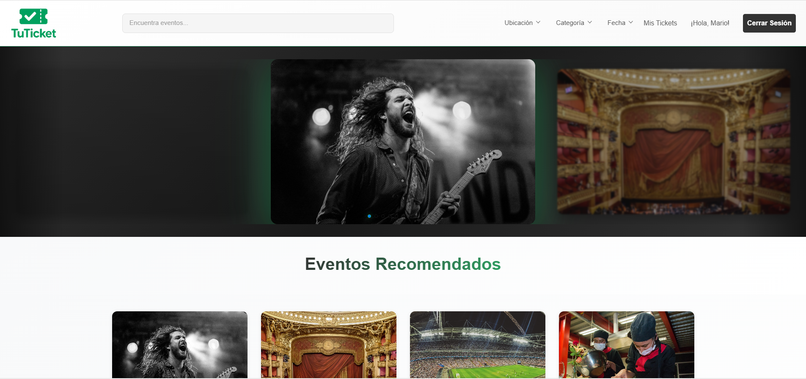
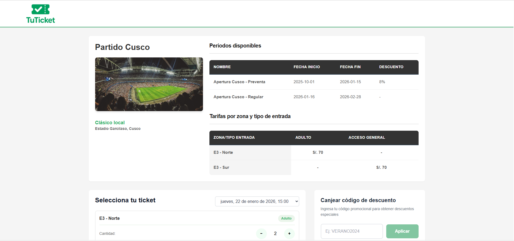
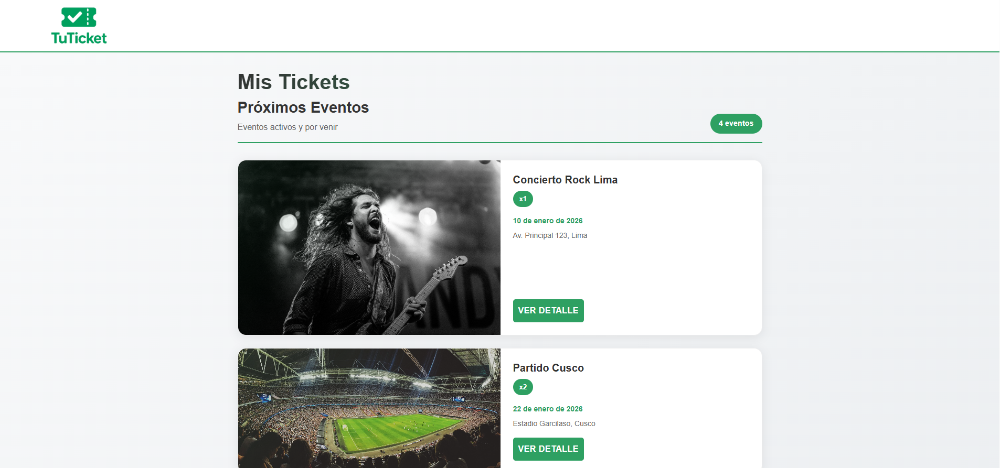
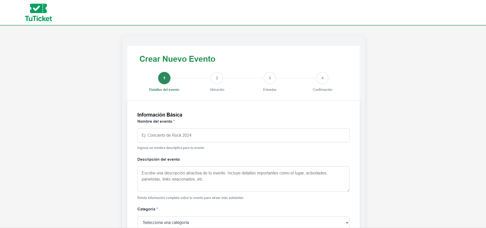
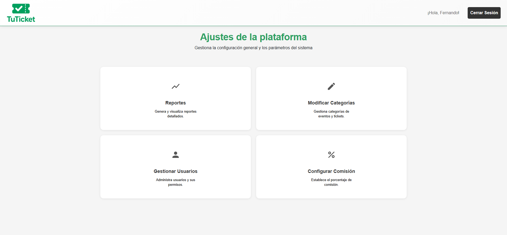

# TicketSync

Proyecto del grupo **"Los Guardianes"** para el curso de Ingeniería de Software [1INF37].

TicketSync es una plataforma integral para la creación, gestión y compra de tickets para eventos, diseñada para simular el flujo completo.

##  Descripción

Este proyecto implementa una aplicación web completa (Full Stack) que permite:
- A los **usuarios**, explorar eventos y comprar tickets.
- A los **organizadores**, crear, editar y eliminar sus propios eventos.
- A los **administradores**, acceso a funciones administrativas y analíticas como gestión de usuarios y visualización de reportes.

La arquitectura sigue un modelo cliente-servidor:
* **Frontend (cliente):** Una aplicación de una sola página (SPA) construida con React.
* **Backend (servidor):** Una API RESTful robusta desarrollada con Spring Boot.

## Tecnologías Utilizadas

### Frontend
* **React:** Biblioteca principal para construir la interfaz de usuario.
* **React Router:** Para la navegación y enrutamiento del lado del cliente.
* **CSS / Tailwind CSS:** Estilizado de componentes.

### Backend
* **Java:** Lenguaje de programación principal.
* **Spring Boot:** Framework para la creación de la API

---

## Capturas del proyecto

### Página principal

### Compra

### Tickets

### Crear Evento

### Panel de Administración

